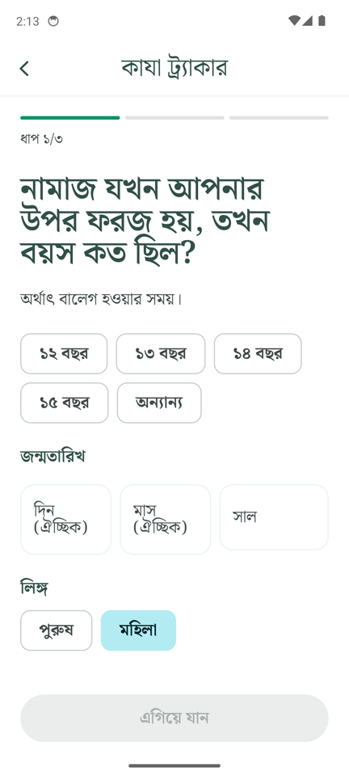
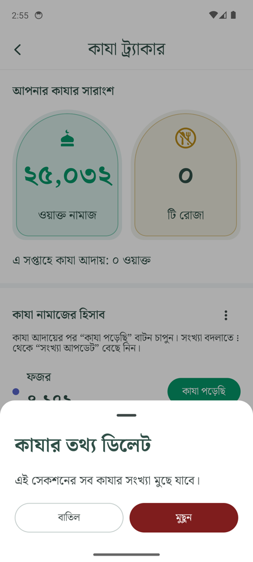
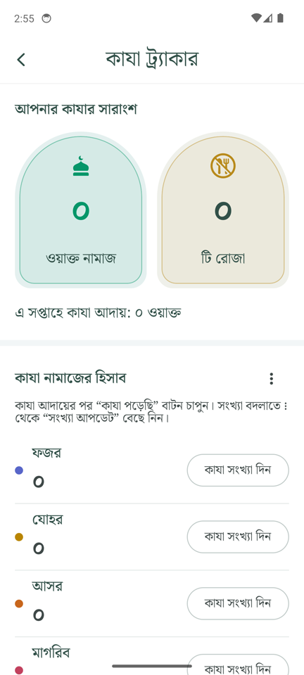
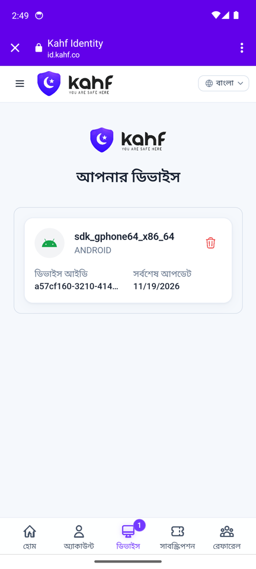

# Muslims Day (Kahf) — Privacy Audit of the Android App

Independent consumer-privacy research on **Muslims Day 6.4.1** (`theoaktroop.appoframadan`, versionCode 292), a prayer-times / Quran app published by Kahf / Halalz.

The research combines **static analysis** (decompiling the APK) with **live traffic capture** (HTTPS decrypted on a test emulator) and a **logged-in test** with a throwaway account. Every claim below has evidence behind it: decompiled code, a decoded manifest entry, or a captured request.

> **Scope:** the Android app only. Kahf Guard, Kahf Browser, Kahf Kids, the Kahf router and the iOS app were **not** analysed.

---

## TL;DR

| Question | Answer |
|---|---|
| Is it malware / spyware? | **No.** No code reads SMS, contacts, call logs, files, photos, camera, microphone, clipboard, the installed-app list, or other apps' screens. There is no Accessibility service and no screen-capture API. |
| Does it track you? | **Yes, heavily.** Five telemetry services: **Google Firebase** (Analytics + Crashlytics), **Microsoft Clarity** (session replay), **Facebook SDK**, and Kahf's own **OpenPanel** analytics on `op.kahf.co.uk`. Nearly every tap and screen becomes an event. |
| Biggest concern | Once you sign in with a Kahf ID, your **email and name** (and phone number, if your account has one) are sent to **Google Firebase**, **Microsoft Clarity** and Kahf's **OpenPanel**. OpenPanel then files **every prayer tick, qaza entry, dhikr count and Quran screen under your email address**. *Confirmed live.* |
| Screen recording? | **Yes, inside the app only.** Microsoft Clarity records Muslims Day's own screens, taps and visible text (Balanced masking). It is **switched on in production** through Remote Config, with no consent prompt and no mention in the privacy policy. |
| Facebook | The SDK sends **install and app-open events at first launch, before any interaction**, with device model, carrier, screen size, timezone and locale. |
| Location | Precise GPS stays **on the device** (prayer times / qibla). Only the **city and country name** reach Kahf's server. The coordinates never appeared in any captured request. |
| Retention & deletion | Kahf's server keeps your prayer ticks (to the second), dhikr counts and qaza history. **There is no account-deletion option** in the app or on the Kahf ID website. The "Delete qaza data" button only writes negative corrections, so **the history stays on the server**. |
| Disclosures | Play Store label: *"doesn't share user data"*, collects only "App interactions". App Store label: *"Data Not Collected"*. The privacy policy never mentions Microsoft, Facebook, session recording, or email-linked analytics. **The disclosures do not match observed behaviour.** |

---

## Contents
1. [Method](#1-method)
2. [Permissions](#2-permissions)
3. [Third-party SDKs and what they receive](#3-third-party-sdks-and-what-they-receive)
4. [Kahf's own backend](#4-kahfs-own-backend)
5. [Live capture — not logged in](#5-live-capture--not-logged-in)
6. [Live capture — logged in (throwaway account)](#6-live-capture--logged-in-throwaway-account)
7. [Server-side retention and deletion test](#7-server-side-retention-and-deletion-test)
8. [Disclosures vs. reality](#8-disclosures-vs-reality)
9. [What each vendor may do with the data](#9-what-each-vendor-may-do-with-the-data)
10. [Other observations](#10-other-observations)
11. [Recommendations](#11-recommendations)
12. [Limitations](#12-limitations)
13. [Ethics and disclaimer](#13-ethics-and-disclaimer)

Evidence: [`evidence/`](evidence) (redacted request/response excerpts) and [`screenshots/`](screenshots).

---

## 1. Method

| Step | Tools |
|---|---|
| Unpack the XAPK (base APK + 23 config splits), decode `AndroidManifest.xml`, dump every DEX string | Python (custom AXML/DEX parser) |
| Decompile all 3 DEX files (17,943 classes); trace data flows by hand | [REA](https://github.com/morluto/rea) with JADX (`jadx-headless-mcp` 0.7.1, checksum-verified) |
| Run the app on an Android 14 (Google APIs) emulator with the mitmproxy CA in the system trust store; record all HTTPS traffic | Android Emulator, mitmproxy 12.3.1 |
| Exercise the app: onboarding, prayer tracking, Quran, Dua, qaza estimator, login, wipe and re-login, delete qaza data | adb |
| Read the local Firebase upload queue to confirm queued user properties | SQLite (root on emulator) |
| Compare against the Play/App Store labels, the privacy policy and vendor terms | Public web pages (fetched 2026-11-19) |

Base APK SHA-256: `0017d838f9e9f94ac75cdf571a822e8808f4bc67ebb92f9593d50957423741b3`.
Class names such as `defpackage/ry8` are R8-obfuscated names from the decompiled source.

---

## 2. Permissions

**Runtime (user-granted):** `ACCESS_FINE_LOCATION`, `ACCESS_COARSE_LOCATION` (prayer times, qibla), `POST_NOTIFICATIONS`.

**Special access:** `SCHEDULE_EXACT_ALARM` / `USE_EXACT_ALARM` / `SET_ALARM` (prayer alarms), `USE_FULL_SCREEN_INTENT` (lock-screen alarm), `ACCESS_NOTIFICATION_POLICY` (Auto-Silent / Do Not Disturb), `REQUEST_IGNORE_BATTERY_OPTIMIZATIONS`.

**Normal:** `INTERNET`, `ACCESS_NETWORK_STATE`, `VIBRATE`, `WAKE_LOCK`, `FOREGROUND_SERVICE` (+ `MEDIA_PLAYBACK` for audio), `RECEIVE_BOOT_COMPLETED`, `MODIFY_AUDIO_SETTINGS`, `BILLING`, `GET_TASKS` / `REORDER_TASKS` (legacy), push, Play Install Referrer.

**Ad / attribution (Privacy Sandbox, merged in by Firebase):** `ACCESS_ADSERVICES_AD_ID`, `_ATTRIBUTION`, `_CUSTOM_AUDIENCE`, `_TOPICS`.

**Absent:** contacts, SMS, call log, phone state, camera, microphone, storage/media, `QUERY_ALL_PACKAGES`, background location, `GET_ACCOUNTS`, `com.google.android.gms.permission.AD_ID`, Accessibility service, screen capture (MediaProjection), overlay.

The permissions match the app's features. The privacy problems come from **telemetry**, not from permissions.

---

## 3. Third-party SDKs and what they receive

| SDK | Endpoint | What it receives | Notes |
|---|---|---|---|
| **Firebase Analytics** (Google) | `app-measurement.com` | ~200 event types, screen views, app-instance ID, device model/OS. **After login: `email`, `name` (and `phone_number`, if your account has one) as user properties, plus user ID.** | Ad-ID collection is off and `_npa=1`. **Google Signals is on.** Google's Analytics policy forbids sending PII. |
| **Firebase Crashlytics / Sessions** | Google | Crash traces, device info, installation ID | Standard |
| **Firebase Cloud Messaging** | Google | Push token | Standard |
| **Firebase Remote Config + A/B** | Google | App instance, version | Live flags include `clarity_enabled: "true"` and `openpanel_enabled: "true"` |
| **Microsoft Clarity** | `clarity.ms` | **Session replay of in-app screens** (layout, visible text, images, taps), screen names, device signals (model, board, ADB-enabled, developer settings, boot count). **After login: `email`, `name`, user ID as tags.** | Starts only on fresh installs when `clarity_enabled` is true, which it currently is. Masking mode: **Balanced**. Project `xsccj95q8n`. |
| **Facebook SDK** (Core, Login, Share) | `graph.facebook.com` | `MOBILE_APP_INSTALL`, `fb_mobile_activate_app`, SDK events with `anon_id`, device model, carrier, screen, timezone, locale | Auto-initialised. Auto-logging is not disabled. Sent before any user interaction. |
| **OpenPanel** (Kahf, self-hosted) | `op.kahf.co.uk/api/track` | The same events as Firebase. **`identify` with `profileId` = your email**, then every event under that profile | Client ID/secret hard-coded (`sec_2258…`). Sends a **fake User-Agent** ("Android 14; Pixel 8 … Chrome/120"). Logs the full payload to Logcat. |
| **Formbricks** (Kahf, self-hosted) | `form.kahf.co` | Kahf user ID, premium/ansar status, country, survey triggers | |
| **Kahf Ads SDK** | `*.kahfads.com` | Device model/maker, OS, timezone, a random per-install UUID (hashed) | Latitude/longitude fields exist but the app passes `null`. No advertising ID. |
| Google Maps, Play Billing, Mahfil.net feed | Google / `api.mahfil.net` | Map tiles, purchases, video feed paging | Standard |

Code references: identify fan-out `defpackage/t.java` → sinks `ro.java` (Firebase), `zu1.java` (Clarity), `ry8.java` (OpenPanel). Clarity gate: `cm0.java`.

---

## 4. Kahf's own backend

| Endpoint | Data |
|---|---|
| `POST backend.muslimsday.com/api/v1/devices` | Random device UUID, FCM token, `kahf_user_id`, flags: app/content language, **country, city**, theme, app version, push enabled |
| `POST /api/v1/auth/sessions` | Device UUID, app version, Kahf user ID → backend JWT |
| `POST /api/v1/habits/sync` | Daily prayer ticks with timezone; amal/dhikr events (item, count, goal) |
| `POST /api/v1/qaza/sync` | Missed-prayer ledger (opening, missed, made-up, corrections) **and a `profile` setting with birth date and gender** |
| `POST /api/v1/referrals` | Referral code, referee device, UTM fields |
| `id.kahf.co/graphql` | Kahf ID profile: name, email, phone, Google profile photo URL, subscriptions, device registry |

Device IDs are random UUIDs generated by the app, not hardware identifiers.

---

## 5. Live capture — not logged in

Android 14 emulator, GPS set to Dhaka. Fresh install → onboarding → allowed location → ticked Fajr → opened Surah Al-Kahf → Dua tab. 732 requests were recorded (app and system).

1. **First launch, before any tap:**
   - **Facebook** received `MOBILE_APP_INSTALL` and `fb_mobile_activate_app`.
   - **Kahf backend** received city/country (guessed from timezone before location was granted) and the push token.
   - **Remote Config** returned `clarity_enabled: "true"`.

   → [`evidence/01-first-launch-no-login.md`](evidence/01-first-launch-no-login.md)
2. **Location:** the exact coordinates (23.8103, 90.4125) appear in **no** request. Only "Dhaka, Bangladesh" was sent.
3. **Religious activity as analytics (OpenPanel + Firebase):**
   ```
   prayer_track_checkbox_clicked {waqt: 0, checked: true}     ← ticking Fajr
   screen_view_detailed {screen_name: quran_reading, chapter_number: 18}   ← reading Al-Kahf
   dua_landing_page_open, menu_item_click {item: QURAN|DUA}, …
   ```
4. **Clarity (from the second launch):** downloaded `maskingMode: 0` (Balanced). It uploaded ~300 KB of session data to `i.clarity.ms/collect` plus WebP images of UI elements. On-screen text such as *"Dhaka, Dhaka District"* is inside the recording.
5. **Not seen:** contacts, SMS, installed-app lists, IMEI, advertising ID, precise GPS.

---

## 6. Live capture — logged in (throwaway account)

A throwaway Kahf ID was created through Google sign-in. Its email and name are shown as `<test-email>` / `<test-name>` in the evidence.

The test: tick Fajr and Dhuhr → 5× Istighfar → run the **qaza estimator with fake data** (born 1995-03-07, male) → restart.

| Destination | What arrived | Evidence |
|---|---|---|
| **Google Firebase** (`app-measurement.com/a`) | User properties **`email`**, **`name`**, `_id` = Kahf user ID. The same rows were also in Play services' local queue | [`03-firebase-upload.md`](evidence/03-firebase-upload.md) |
| **Microsoft Clarity** (`j.clarity.ms/collect`) | Session tags **`email`**, **`name`**, `userId`, plus device signals | [`02-logged-in-identity.md`](evidence/02-logged-in-identity.md) |
| **Kahf OpenPanel** | `identify` with **`profileId` = email**. Then every event carries it: `prayer_track_checkbox_clicked {waqt 0/2}`, `daily_amal_open`, `qaza_open`, `qaza_estimator_step 1–3`, Quran/Dua screens | [`02-logged-in-identity.md`](evidence/02-logged-in-identity.md) |
| **Kahf backend** | Prayer ticks, dhikr count, qaza estimate (4,172 × 6 prayers) and **`profile: {birth_date, gender}`**. The server replied `unknown_setting` for `profile` | [`02-logged-in-identity.md`](evidence/02-logged-in-identity.md) |
| Formbricks | Kahf user ID + attributes (no email) | same |
| Facebook / Kahf Ads | **No** email or name | — |

---

## 7. Server-side retention and deletion test

No server was probed directly. Only the app's own requests were used, on the throwaway account. → [`evidence/04-retention-and-deletion.md`](evidence/04-retention-and-deletion.md)

**After wiping all app data and signing in again, the server restored:**
- Prayer ticks **with exact timestamps** (e.g. `2026-11-19T08:12:16.961Z`)
- The Istighfar count (5/100)
- The qaza totals (25,032)
- Birth date / gender were **not** returned (`settings: []`). This is consistent with the server rejecting them.

**Device records pile up.** Every reinstall or wipe registers a new device on the backend and on Kahf ID. Old records stay until the account hits a 2-device limit.

**"Delete qaza data" doesn't erase anything.** It sends six `"type":"correction","count":-4172` events instead of the `DELETE /api/v1/qaza` endpoint that exists in the code. The server's answer keeps `opening_total: 4172` and `correction_total: -4172`. **The history remains; only the balance shows 0.**

**There is no account deletion:**
- The app has only "Sign out".
- The Kahf ID portal (Home, Account, Devices, Subscription, Referral) has no delete or data-export option.
- No delete-account endpoint exists in the code.

The privacy policy offers deletion by email or "in-app if available". Google Play requires apps that create accounts to offer deletion both in the app and on the web.

<p>




</p>

---

## 8. Disclosures vs. reality

Sources (fetched 2026-11-19): [Play Store Data safety](https://play.google.com/store/apps/datasafety?id=theoaktroop.appoframadan), [privacy policy](https://muslimsday.com/privacy) (updated 2026-08-09), [App Store listing](https://apps.apple.com/us/app/-/id1613431376).

| Topic | Disclosed | Observed | Verdict |
|---|---|---|---|
| Sharing | Play: no data shared with other companies | Email/name to Google and Microsoft; install/open events to Facebook | **Contradicts** (Facebook is not a service provider acting for Kahf) |
| Data types | Play: only "App interactions" | Plus email, name, approximate location, device/app IDs, crash data, screen recordings | **Under-declared** |
| App Store | "Data Not Collected" | Same backend and SDK design (iOS not tested) | **Very likely wrong** |
| Named third parties | Only Google (as a sign-in option) | Firebase, Microsoft Clarity, Meta, OpenPanel, Formbricks, Mahfil | **Undisclosed** |
| Session recording | Not mentioned | Clarity is on in production | **Undisclosed** |
| Precise location | Used on the device, not stored | Never left the device | **Consistent** |
| Birth date / gender | Not mentioned | Sent; the server says it rejects them | **Undisclosed collection attempt** |
| PII in Analytics | — | Email/name sent to Firebase | **Violates Google's Analytics policy** |
| Encryption | HTTPS | HTTPS only, cleartext disabled | **Consistent** |
| Deletion | "You can request deletion" | No in-app/web option; qaza "delete" keeps history | **Weak** |

---

## 9. What each vendor may do with the data

| Vendor | Received | Per its own terms | Retention |
|---|---|---|---|
| **Kahf** (backend, Kahf ID, OpenPanel, Formbricks, all self-hosted) | Identity, device rows, city, push token, full prayer/qaza/dhikr history, all analytics under your email | Only Kahf's privacy policy applies (no sale; sharing with "service providers") | "As long as needed". **Observed: indefinite, no self-service deletion** |
| **Google** (Firebase) | Email, name, user ID, events, device info; Google Signals on | Processor for Firebase, but the app breaks Google's [no-PII rule](https://support.google.com/analytics/answer/6366371). Signals links data to signed-in Google accounts | Events 2 or 14 months; Signals up to 26 months ([source](https://support.google.com/analytics/answer/7667196)) |
| **Microsoft** (Clarity) | Session replays, visible text, device signals, email/name tags | Clarity *"operates as a data controller"* under the Microsoft Privacy Statement. Explicit consent is required for EEA/UK/CH users; the app shows no consent prompt ([FAQ](https://learn.microsoft.com/en-us/clarity/faq)) | Recordings 30 days; some session data and heatmaps 13 months ([source](https://learn.microsoft.com/en-gb/clarity/data-retention)) |
| **Meta** (Facebook SDK) | Install/open events with device data | Usable for ad measurement, audience targeting, delivery optimisation and R&D. Apps must give a clear notice with an opt-out link; the Muslims Day policy doesn't ([Business Tools Terms](https://www.facebook.com/legal/technology_terms)) | Not stated |

What actually happens inside these companies beyond their stated terms **cannot be verified from outside**.

---

## 10. Other observations
- **`BrowserKillerService`** (Kahf ID SDK): after a browser login it sends you to the home screen, broadcasts a Chrome "close tabs" intent and runs `am force-stop com.android.chrome` / `killall chrome`. These commands fail without root. Aggressive, but not data theft.
- **Kahf account authenticator:** adds a "Kahf" account to Android Accounts for single sign-on across Kahf apps.
- **Exported receivers without permission:** `ScheduledNotificationReceiver` and `BootReceiver`. Another app could trigger a notification display (minor).
- **`allowBackup="true"`:** app data can be included in Google Drive device backups.
- **Hard-coded credentials:** Firebase API key, Facebook client token, and the **OpenPanel client secret** (partially masked here: `sec_2258…`, client ID `61dfcf2b-…`). With the OpenPanel secret, anyone can write to Kahf's analytics.
- **Quran preview images** load from a personal GitHub repository (`raw.githubusercontent.com/qwer87asdf/qrn`).

---

## 11. Recommendations

**For users**
- Use the app **without signing in to Kahf ID**. That keeps your name and email out of Google, Microsoft and OpenPanel.
- Grant location as **Approximate** and **While using the app**.
- To delete data, email Kahf / Halalz and ask in writing for access to and deletion of your data. Keep the reply.

**For Kahf**
- Stop sending email and name to Firebase and Clarity. Use an opaque ID instead.
- Disclose Clarity session replay and Facebook in the privacy policy, and ask for consent.
- Correct the Play Store and App Store data-safety labels.
- Add real account deletion (in the app and on the web). Make "delete qaza data" actually call `DELETE /api/v1/qaza`.
- Rotate the hard-coded OpenPanel secret.

---

## 12. Limitations
- Android 6.4.1 only, on an emulator. A real device may differ slightly (for example, the advertising ID is unavailable here anyway because the `AD_ID` permission is absent).
- The phone-number path (`phone_number`) was confirmed in code but not live, because the test account used Google sign-in.
- 618 methods could not be fully decompiled; obfuscation may hide minor flows.
- Server-side behaviour was inferred only from the app's own API responses.

## 13. Ethics and disclaimer
This is independent, defensive consumer-privacy research on a publicly distributed app.
- All traffic was the app's own, on an emulator and a test account created for this purpose.
- No servers were scanned, probed, fuzzed or stressed. No authentication was bypassed. No other user's data was accessed.
- Personal data of the test account, tokens and secrets are redacted.
- Please don't use any detail here to attack Kahf's infrastructure.

This report describes observed technical behaviour. It is not legal advice.
